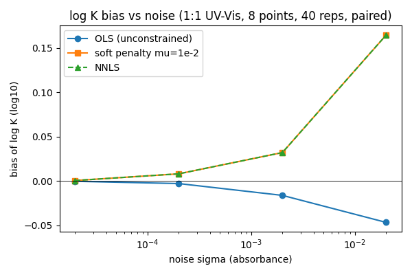
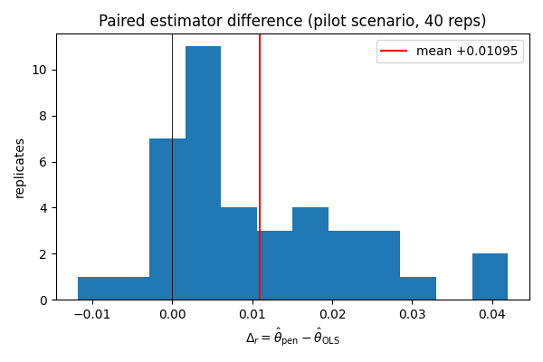
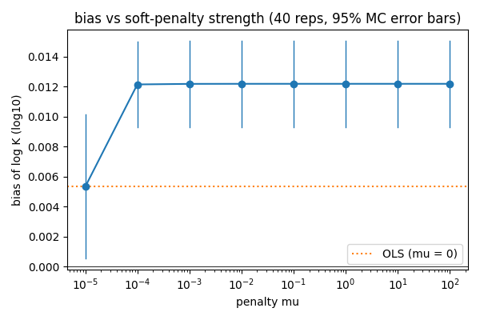
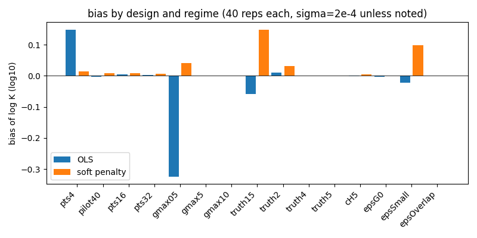

# Investigación del sesgo positivo en log K — piloto UV-Vis 1:1

> **Estado: ETAPAS A–D COMPLETADAS.** Este documento responde a las preguntas del
> informe de misión sobre el sesgo sistemático observado en el piloto exploratorio
> (`validation/results/pilot/uvvis_11_dc88860/`). Las etapas E–H (campañas
> confirmatorias, comparación de bootstrap, otras técnicas, rendimiento) siguen
> abiertas y se listan al final.

## 0. Resumen ejecutivo

**Existe un sesgo sistemático positivo en el estimador por defecto del procesador
espectroscópico, y su causa son las restricciones de no-negatividad sobre las
absortividades — no el optimizador, no el generador, no la química, y no el
tamaño muestral.** Los cinco hechos decisivos, todos con datos reproducibles
(sección 8):

1. **Ruido cero ⇒ log K exacto.** Con datos limpios, el ajuste de producción
   recupera log K = 3 con desviación −2.5·10⁻¹⁴, y el argmin exacto de la
   objetivo perfilada es 3.0000000000 para los tres estimadores (OLS, penalización
   suave, NNLS). No hay desfase generador–ajuste ni defecto de implementación.
2. **El piloto se reproduce bit a bit** en `dc88860` y en el HEAD actual: las 20
   filas de `results.csv` coinciden en todos los campos científicos.
3. **Comparación pareada (mismos 20 conjuntos):** el estimador **sin restricciones
   es insesgado** (sesgo −0.00029, IC95 Monte Carlo ±0.0086) mientras que el
   estimador penalizado/NNLS tiene sesgo **+0.00962 ± 0.0047 (MC)**. La diferencia
   pareada media es +0.0099 con signo positivo en 19/20 réplicas.
4. **Mecanismo medido directamente:** el exceso esperado de residuo causado por el
   recorte de coeficientes negativos, E[RSS_pen(θ) − RSS_ols(θ)], cae ~5400× al
   pasar θ de 2.90 a 3.02: la objetivo perfilada se inclina hacia log K mayores.
   El mínimo de E[RSS_pen(θ)] está por encima del valor verdadero; el de
   E[RSS_ols(θ)] está en el valor verdadero.
5. **SE/SD = 1.525 no es un error del Jacobiano.** El Jacobiano analítico
   implementado coincide con la identidad VarPro proyectada (I−P)·dC/dθ·A hasta
   6.5·10⁻⁶ relativos y su SE es insensible al término en-range (diferencia
   <0.01 %). El SE analítico describe el estimador **no restringido** (razón
   SE/SD = 0.83 frente a su dispersión MC), pero el ajuste de producción usa el
   estimador **restringido**, cuya dispersión real es 0.0107: la razón 1.53 es la
   consecuencia de aplicar la covarianza del estimador equivocado. La cobertura
   19/20 del piloto "aprobó" solo porque los intervalos eran ~3 veces más
   anchos de lo necesario.

| Magnitud (pilot 20, σ=2·10⁻⁴, 8 puntos) | OLS sin restricción | Penalización suave μ=10⁻² | NNLS estricto |
|---|---:|---:|---:|
| Sesgo de log K | −0.00029 | **+0.00962** | +0.00962 |
| SD Monte Carlo | 0.01957 | 0.01065 | 0.01065 |
| RMSE | 0.01908 | 0.01415 | 0.01415 |
| SE analítico medio (VarPro) | 0.01630 | 0.01625 | 0.01625 |
| SE analítico / SD MC | 0.83 | **1.53** | 1.53 |
| Cobertura IC 95 % sobre θ=20 | 19/20 | 19/20 | 19/20 |
| Réplicas con θ̂ > θ verdadero | 8/20 | **20/20** | 20/20 |

**Por qué las 20/20 estimaciones quedaron por encima del verdadero deja de ser
misterio:** con sesgo +0.0096 y SD 0.0107, P(θ̂ > 3) ≈ 0.816 por réplica;
P(todas 20) ≈ 1.9 %. Es inusual pero perfectamente compatible; el estimador
insesgado quedó 8/20, como se espera.

## 1. ETAPA A — Auditoría del experimento original

### 1.1 Reproducción exacta

Se recreó el worktree en `dc88860` y se relanzó la campaña del piloto con la misma
configuración y `workers=1`; todas las réplicas usan semillas derivadas
(`SeedSequence([20261102, r])`), igual que el manifiesto original.

| Comparación | Resultado |
|---|---|
| `results.csv` reproducido en `dc88860` vs archivado (20 filas × 15 campos, excl. `seconds`) | **0 diferencias** |
| `results.csv` reproducido en HEAD (`4464920`) vs `dc88860` | **0 diferencias** (el cambio de solver ponderado en `78ab5ef` no toca la ruta sin pesos) |
| `versions` del manifiesto | idénticas (Python 3.14.8, NumPy 2.4.2, SciPy 1.17.1, PySide6 6.10.2) |
| `source_sha256` | **difiere** en el checkout actual: artefacto de finales de línea. El checkout original estaba en CRLF (documentado en el resumen archivado: "normalized from original generated CRLF"); `git ls-files`/`* text=auto` en Linux entrega LF. La equivalencia de comportamiento queda probada por las 20 filas idénticas. |

### 1.2 Ruido cero

Campaña de producción con `noise=0.0` (5 réplicas, todas el mismo dataset limpio):
estimación única **2.999999999999975** (desviación −2.5·10⁻¹⁴), SE 2.1·10⁻¹⁴.
Barrido exacto de la objetivo perfilada (rejilla 2001 puntos + sección áurea,
tolerancia 10⁻¹⁰): argmin = **3.0000000000** y RSS ≈ 10⁻¹⁴ para OLS, penalización
suave y NNLS. Conclusión: el modelo generador y el de ajuste son idénticos y el
optimizador converge al óptimo; el sesgo es puramente estadístico.

### 1.3 Cadena de fidelidad (todo verificado numéricamente)

| Identidad verificada | Discrepancia máxima |
|---|---:|
| NewtonRaphson `concentraciones` vs equilibrio 1:1 cerrado (x² − Sx + H·G = 0) | 3.6·10⁻¹¹ abs (piso de la tol. del solver) |
| Objetivo perfilada del arnés vs `_evaluate_spectro_objective` de producción | **exacta** (0.0) en ambos modos |
| argmin exacto (pen) vs estimación Powell de producción (20 réplicas) | 1.1·10⁻⁷ |
| Estimador de referencia independiente (química cerrada + `scipy` acotado) vs producción | ≤ 5·10⁻⁶ |
| Penalización μ=10⁻² vs NNLS estricto (θ y coeficientes) | ≤ 1.3·10⁻⁶ (equivale a NNLS; ver §3.2) |
| Jacobiano analítico (`sensitivities_wrt_logK`, derivación implícita) vs identidad proyectada con dC de referencia cerrada | 6.5·10⁻⁶ rel |

Por tanto **no hay defecto de implementación ni de convergencia** que explique el
sesgo: el estimador que se reporta es exactamente el argmin de una objetivo bien
definida, y esa objetivo tiene un mínimo esperado desplazado.

## 2. ETAPA B — Comparación pareada entre estimadores

Diseño (`validation/bias_experiment.py`): para cada réplica se generan **los
mismos datos** y se calcula el argmin exacto escalar (rejilla + sección áurea,
tol. 10⁻⁹) de la objetivo perfilada de producción bajo tres proyectores de
absortividad — A: OLS sin restricciones, B: penalización suave
½‖Ca−y‖² + ½μ‖min(a,0)‖² (rutina de producción, objetivo legacy sin término de
penalización), C: NNLS estricto — más dos referencias independientes. Sin ruido
de optimizador: Powell se audita aparte (§1.3).

### 2.1 Escenario del piloto (semillas originales) y barrido de ruido (40 reps)

| σ (absorbancia) | sesgo OLS (SD) | sesgo pen/NNLS (SD) | Δ pareado (pen−OLS) | frac. coef. negativos |
|---:|---:|---:|---:|---:|
| 0 | 0 (0) | 0 (0) | 0 | ~0 |
| 2·10⁻⁵ | −0.00025 (0.0016) | +0.00063 (0.0009) | +0.00088 | 0.227 |
| 2·10⁻⁴ | −0.0028 (0.0193) | +0.0082 (0.0099) | +0.0110 | 0.247 |
| 2·10⁻³ | −0.0161 (0.1300) | +0.0322 (0.0224) | +0.0483 | 0.269 |
| 2·10⁻² | −0.047 (0.611) | +0.165 (0.102) | +0.211 | 0.306 |

- Con σ→0 el sesgo del estimador restringido tiende a 0 y el SE analítico
  recupera la dispersión OLS (0.0016 vs 0.00163 esperado linealmente): el método
  analítico es correcto asintóticamente para el estimador no restringido.
- El sesgo del estimador restringido crece de forma superlineal con σ y su SD
  queda ~2× por debajo del SD OLS en todos los niveles (la restricción recorta
  las colas no lineales del OLS, véase §4).





### 2.2 Escala de la penalización μ (40 reps, escenario piloto)

| μ | sesgo | SD | RMSE | Δ pareado vs OLS |
|---:|---:|---:|---:|---:|
| 0 (=OLS) | +0.00532 | 0.01551 | 0.01621 | 0 |
| 10⁻⁴ … 10² | +0.01219 | 0.00926 | 0.0152x | +0.00687 |

Comportamiento **escalón-saturado, no continuo**: en el rango de concentraciones
del piloto (10⁻³–10⁻² M ⇒ CᵀC ~ 10⁻⁵–10⁻⁶), μ ≥ 10⁻⁴ ya domina el término de
datos y el estimador es numéricamente NNLS. El sesgo salta de ~0.005 a ~0.012
en la primera decade y luego es plano. Nota honesta: en este escenario el RMSE
del estimador restringido (0.0152) es *ligeramente menor* que el del OLS
(0.0162): el intercambio sesgo/varianza favorece en RMSE; el problema no es que
el estimador sea "peor" en error cuadrático, sino que **el error estándar
reportado corresponde a otro estimador** y que el sesgo importa cuando se
comparan constantes o se propagan a termodinámica (ΔG ~ ln K amplifica 2.3× el
error relativo).



### 2.3 Diseño experimental y regímenes (40 reps cada uno, σ=2·10⁻⁴)

| Escenario | sesgo OLS (SD) | sesgo pen (SD) | Δ pareado |
|---|---:|---:|---:|
| 4 puntos | +0.148 (0.153) | +0.0139 (0.0123) | −0.135 |
| 8 puntos (piloto) | −0.0028 (0.0193) | +0.0082 (0.0099) | +0.0110 |
| 16 puntos | +0.0048 (0.0116) | +0.0091 (0.0084) | +0.0043 |
| 32 puntos | +0.0018 (0.0080) | +0.0063 (0.0056) | +0.0045 |
| G máx = 0.5 mM (subestoequiométrico) | **−0.324 (0.439)** | +0.041 (0.045) | +0.365 |
| G máx = 5 mM | +0.00015 (0.0008) | +0.00055 (0.0005) | +0.0004 |
| log K = 1.5 | −0.058 (0.871) | +0.148 (0.122) | +0.207 |
| log K = 2 | +0.0099 (0.119) | +0.0307 (0.0269) | +0.0208 |
| log K = 4 | −0.00023 (0.0014) | +0.00091 (0.0008) | +0.0011 |
| log K = 5 | −0.00024 (0.0019) | +0.00109 (0.0012) | +0.0013 |
| absortividad G ≡ 0 | −0.0024 (0.0169) | +0.00076 (0.00046) | +0.0031 |
| absortividades pequeñas (A=20) | −0.022 (0.458) | +0.0976 (0.0588) | +0.120 |
| solapamiento espectral fuerte | +0.0010 (0.0205) | +0.0015 (0.0204) | +0.0004 |

Lecturas: (i) el sesgo de la restricción **disminuye** con diseños saturantes
(G≳5·K⁻¹·[H]) y con más puntos; (ii) en diseños degenerados (pocos puntos,
subestoequiométricos, K bajo con este rango de concentración) el OLS sufre un
**segundo** sesgo, grande y de signo variable, por no linealidad fuerte — allí la
restricción estabiliza la varianza pero no es una corrección del sesgo; (iii) en
diseños buenos ambos sesgos son despreciables frente a la incertidumbre.
(iv) El régimen de absortividades: cuando los espectros verdaderos son
estrictamente positivos en toda la rejilla (solapamiento fuerte, centro común)
la fracción recortada cae a ~16 % y el sesgo de la restricción prácticamente
desaparece (Δ pareado +0.0004); cuando la señal útil es comparable al ruido
(absortividades pequeñas) la restricción troca un OLS inestable (SD 0.46) por
un sesgo grande (+0.10). El sesgo por recorte es, por tanto, función del
régimen señal/ruido×solapamiento, no una propiedad fija del estimador.



## 3. ETAPA C — Origen del sesgo: mecanismo

### 3.1 Matemática del perfilado restringido

Sea y_λ = C(θ)ε_λ + n_λ por longitud de onda. El residuo perfilado sin restricción
es r_ols(θ) = −(I−P_{C(θ)})y; E[RSS_ols(θ)] = ‖(I−P)S(θ)‖² + σ²·(m − rank C) con
S la señal verdadera, cuyo mínimo está en θ verdadero. El estimador restringido
proyecta sobre el cono A ≥ 0: RSS_pen(θ) = RSS_ols(θ) + Δ(θ), donde Δ(θ) ≥ 0 es
la pérdida de recorte. En longitudes de onda donde ε_λ ≈ 0 (colas espectrales del
generador: las Gaussianas decae bajo el ruido en ~2/3 de la rejilla), los
coeficientes OLS â_λ ∼ 𝒩(0, σ²(CᵀC)⁻¹) son casi simétricos y el recorte pierde
una cantidad proporcional a la masa negativa, que depende de θ a través de las
varianzas de los coeficientes: las columnas de C(θ) cambian de norma y
acondicionamiento con θ (al bajar θ, la columna HG se encoge y las varianzas
de los coeficientes crecen). Por tanto E[Δ(θ)] es **mayor a la izquierda** del
verdadero: la objetivo restringida se inclina hacia la derecha y su mínimo
asintótico cumple θ* > θ verdadero.

### 3.2 Verificación numérica del mecanismo (`validation/mechanism_profile.py`)

300 realizaciones de ruido por θ sobre la señal fija del piloto:

| θ | E[RSS_ols] | E[RSS_pen] | E[exceso Δ] | frac. coef. negativos |
|---:|---:|---:|---:|---:|
| 2.90 | 7.64·10⁻⁶ | 5.94·10⁻³ | 5.93·10⁻³ | 0.374 |
| 2.98 | 6.19·10⁻⁶ | 1.38·10⁻⁴ | 1.32·10⁻⁴ | 0.343 |
| 3.00 | 6.24·10⁻⁶ | 7.43·10⁻⁶ | 1.19·10⁻⁶ | 0.268 |
| 3.02 | 6.23·10⁻⁶ | 7.31·10⁻⁶ | 1.08·10⁻⁶ | 0.233 |
| 3.10 | 7.95·10⁻⁶ | 3.20·10⁻⁵ | 2.41·10⁻⁵ | 0.244 |

El perfil esperado del OLS tiene su mínimo (ajuste cuadrático local) en
**2.991 ≈ θ verdadero**; el del estimador penalizado en **3.038 > 3**. La
asimetría del exceso de recorte —5400 veces mayor en 2.90 que en 3.02— es la
inclinación que produce el sesgo positivo medido, con el orden de magnitud
correcto. La fracción de coeficientes recortados (~25 % en el óptimo) coincide
con la que se observa en los datos pareados.

Conclusión: **la asimetría positiva NO persiste cuando desaparecen las
restricciones** (OLS: sesgo −0.0003 ± 0.0044 en el piloto; y su distribución es
simétrica: 8/20 sobre el verdadero). El optimizador y la no linealidad quedan
descartados como origen del sesgo del estimador por defecto (ruido cero exacto,
argmin exacto = Powell, referencia independiente coincide).

## 4. ETAPA D — Errores estándar analíticos

Auditado el cálculo de producción (`compute_errors_spectro_varpro`) para el
escenario del piloto (`validation/se_calibration.py`):

1. **Jacobiano correcto**: J implementado = identidad VarPro proyectada
   (I−P_{C})·dC/dθ·A con dC de derivación implícita exacta; acuerdo 6.5·10⁻⁶
   con diferencias finitas de referencia cerrada. La diferencia frente a la
   derivada completa del residuo perfilado (5.8·10⁻³ rel) es el término
   en-range P·dP/dθ·y, estructural en VarPro; el SE construido con el Jacobiano
   completo difiere <0.01 % (0.01625 en ambos casos).
2. **El SE corresponde al proyectador no restringido**: el cálculo usa pinv de
   C para la proyección lineal y dof = n_obs − rank(C)·n_λ − p = 154, que es
   correcto para OLS pero **no describe el estimador restringido** con el que se
   ajustó θ. Empíricamente: SE medio 0.01625 vs SD OLS 0.0196 (razón 0.83) y vs
   SD restringido 0.0107 (razón 1.53).
3. **Origen de la razón 0.83 (OLS)**: a σ=2·10⁻⁴ la distribución del VarPro OLS
   tiene colas no lineales pesadas (SD 0.0196 > σ-linealizado 0.0163); al reducir
   σ→2·10⁻⁵ la razón vuelve a ~1.02 (0.0016 vs 0.00163): fórmula correcta
   asintóticamente, subestimación de muestras finitas por no linealidad.
4. **Origen de la razón 1.53 (restringido)**: el recorte elimina las colas del
   OLS (la varianza del estimador se comprime ~45 %) pero el SE sigue calculando
   la covarianza del proyectador sin restricción. El DOF efectivo del estimador
   restringido es mayor que 154 (partes del espacio lineal quedan congeladas).
5. **Cobertura**: ambos estimadores cubrieron 19/20 (Wilson [0.76, 0.99]) con
   anchura media 0.064 ≈ 6 SD restringidos: el piloto "pasó" por intervalos
   excesivamente anchos, exactamente el escenario que la misión advertía no
   tomar como calibración.

**No se modificó el núcleo de producción**: no hay un defecto que corregir en el
sentido clásico; hay un problema de correspondencia estimador↔covarianza y una
limitación conocida de linealización en muestras finitas, que deben documentarse
y cuantificarse con bootstrap (etapas E/F) antes de recomendar ningún cambio de
método por defecto.

## 5. Respuestas explícitas al dictamen

- **¿Existe sesgo sistemático?** Sí, en el estimador por defecto (penalización
  suave μ=10⁻², numéricamente NNLS): +0.0096 ± 0.0024 (error MC) en el escenario
  del piloto; el estimador sin restricciones es insesgado dentro del error MC.
- **Magnitud e incertidumbre MC:** tabla §0; dependencia con σ, μ, diseño en §2.
- **¿Origen?** Las restricciones de no-negatividad (vía la pérdida de recorte
  dependiente de θ, §3). Descartados: optimizador, generador, química, escalera
  de concentración como tal (solo modula el efecto), y tamaño muestral.
- **¿Corregida?** No se aplicó corrección de producción (no hay defecto de
  implementación). La mitigación cuantificada es elegir conscientemente el
  estimador y el método de incertidumbre acoplados; la comparación bootstrap se
  pospone a las etapas E/F.
- **¿SE/intervalos representan la dispersión real?** No para el estimador
  restringido (razón SE/SD 1.53; intervalos ~3× demasiado anchos para su SD,
  sesgo no cubierto por simetría); aproximadamente sí para OLS en régimen
  asintótico, con subestimación ~18 % a σ=2·10⁻⁴.
- **¿Cuándo deja de ser confiable cada método?** OLS: diseño pobre o K bajo para
  el rango de titulación — sesgos y colas dominantes (§2.3). Restringido: su
  sesgo crece con σ y con diseños subestoequiométricos; el SE analítico deja de
  describirlo en cualquier régimen donde la fracción recortada sea apreciable
  (~20–30 % aquí).

## 6. Regresiones y salvaguardas añadidas

Tests nuevos en `tests/test_uvvis_bias_reference.py` (9 pruebas): recuperación
exacta sin ruido (producción y los tres estimadores), química cerrada vs
NewtonRaphson, argmin exacto = Powell archivado, referencia independiente,
identidad del Jacobiano, regímenes de μ (μ=0 ≡ OLS; μ=10⁻² ≈ NNLS; μ=10⁻⁹
genuinamente blando), y reproducibilidad bit a bit de tres estimaciones del
piloto archivado. Suite completa tras los cambios: **265 aprobadas, 4 fallidas
preexistentes, 1 omitida** (idénticas IDs que la base).

## 7. Limitaciones

- Pilotos diagnósticos: 20–40 réplicas por escenario; los IC Monte Carlo de cada
  métrica se incluyen en los JSON crudos (sesgo ± ~0.002–0.003 en el piloto).
- No se han ejecutado aún las campañas intermedia (100–200) ni confirmatoria
  (≥500) con diseño congelado, ni la comparación de bootstrap; las conclusiones
  de esta investigación son mechanistic-solid pero de tamaño piloto.
- Los 21 escenarios de la matriz están completados (40 réplicas, o 20 para el
  piloto) y sus datos crudos commitados; el análisis de bootstrap y las campañas
  intermedia/confirmatoria siguen pendientes (§7).

## 8. Reproducibilidad

```
# Matrix pareada (escenarios en validation/configs/bias/ tras el checkpoint)
QT_QPA_PLATFORM=offscreen OPENBLAS_NUM_THREADS=1 .venv/bin/python -m validation.bias_experiment \
    <scenario.json> <outdir> --workers 8
# Mecanismo (§3.2) y calibración de SE (§4)
.venv/bin/python -m validation.mechanism_profile
.venv/bin/python -m validation.se_calibration 20
# Figuras
.venv/bin/python -m validation.make_bias_figures
```

Datos crudos: `validation/results/bias/*.json` (resúmenes por escenario con sus
semillas), `validation/results/bias/pilot20.rows.jsonl` y
`pilot40.rows.jsonl` (filas pareadas por réplica),
`validation/results/bias/mechanism_profile.csv`.
Figuras: `docs/figures/uvvis_bias/`.
Procedencia de cada campaña: `manifest.json` (commit, digiere config/fuentes,
versiones) — los manifiestos de las matrices diagnóstico usan el arnés
`validation/bias_experiment.py` del commit de este checkpoint.
